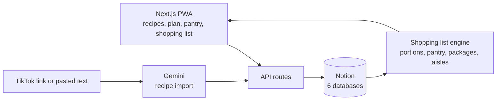

# Planning Repas

*[English version](README.md)*

   

Un planificateur de repas pour deux (ou deux foyers) : recettes, catalogue d'ingrédients, stock avec dates de péremption, planning de la semaine et **liste de courses générée automatiquement** — groupée par rayon, ajustée au nombre de portions, avec un coût estimé.

C'est une petite appli web pensée pour le mobile (installable en PWA) dont la base de données est **Notion** : les données restent modifiables à la main et rien d'autre n'est à héberger. L'interface est en français.

## Architecture en un coup d'œil



## Points forts techniques

- **Notion comme vraie base de données.** Des dépôts typés sur six bases, et `npm run verify:notion` qui compare le schéma réel à ce que le code attend.
- **Une liste de courses qui raisonne en paquets.** Les quantités suivent les portions, le stock est déduit, et le résultat est groupé par rayon avec un coût estimé.
- **Pensée pour le supermarché.** Les coches sont mises en file en local puis envoyées plus tard : une connexion capricieuse n'en perd aucune.
- **Import par LLM sécurisé.** L'import depuis un lien TikTok ou du texte protège l'appel Gemini contre l'injection de prompt et rapproche les ingrédients du catalogue.
- **Deux foyers** qui partagent recettes et ingrédients, chacun avec son stock, son planning et ses courses. 490+ tests Vitest, TypeScript strict.

## Fonctionnalités

- **Recettes** avec portions, ingrédients et quantités ; favoris ; programmer une recette pour la semaine prochaine en deux gestes (icône calendrier ou glissement).
- **Catalogue d'ingrédients** : unité, taille et prix du paquet, durée de conservation, rayon. Les quantités sont gérées en paquets : la liste dit ce qu'il faut *acheter*, pas seulement ce qu'il faut utiliser.
- **Stock** avec dates d'achat et de péremption — ce que tu as déjà est déduit de la liste de courses.
- **Planning de la semaine** (lecture seule ; glisser ou ✕ pour retirer un repas).
- **Liste de courses** de la semaine à venir : groupée par rayon, total estimé, cases à cocher en magasin (marche avec une connexion capricieuse : les coches sont mises en file puis envoyées).
- **Import de recette** depuis un lien TikTok ou du texte collé, analysé par Gemini, avec rapprochement des ingrédients du catalogue (les inconnus sont créés « à compléter »).
- **Notifications** : produits bientôt périmés (≤ 3 jours) et ingrédients à compléter.
- **Deux foyers** qui partagent recettes et ingrédients mais ont chacun leur stock, leur planning et leurs courses.

## Technologies

Next.js 15 (App Router, routes d'API) · React 18 · TypeScript · API Notion (`@notionhq/client`) · Gemini (import de recettes) · Vitest (490+ tests) · systemd pour le déploiement.

## Démarrage

```bash
npm ci
cp .env.example .env.local     # renseigner le jeton Notion, les ID de bases et (en option) une clé Gemini
npm run verify:notion          # vérifie tes bases Notion par rapport au schéma attendu par le code
npm run dev                    # http://localhost:3000
npm test
```

### Configuration de Notion

1. Crée une intégration interne sur <https://www.notion.so/my-integrations> et mets son jeton dans `NOTION_TOKEN`.
2. Crée six bases de données sous une même page parente et partage la page avec l'intégration : **Ingredients, Recipes, RecipeIngredients** (table de jonction), **Pantry, WeeklyPlan, ShoppingChecks**. Mets leurs identifiants dans `.env.local`.
3. Les propriétés et types exacts de chaque base sont listés dans [`scripts/verify-notion-setup.ts`](scripts/verify-notion-setup.ts) ; `npm run verify:notion` indique ce qui manque. `npm run setup:favorite` et `npm run setup:extras` ajoutent les propriétés facultatives, et `npm run setup:household` crée les bases d'un second foyer.
4. `npm run seed:recipes` charge quelques recettes d'exemple.

Les noms de foyer du sélecteur valent « Household 1/2 » par défaut ; renseigne `HOUSEHOLD_1_LABEL` / `HOUSEHOLD_2_LABEL` pour les changer.

## Déploiement

Prévu pour une petite VM Linux : `npm run build && npm run start` (port 3100) sous systemd — voir [`deploy/planning-repas.service`](deploy/planning-repas.service). `deploy/deploy.sh` envoie le code versionné et ton `.env.local` par SSH, reconstruit et redémarre le service ; copie `deploy/deploy.env.example` vers `deploy/deploy.env` pour indiquer ton serveur.

> **Sécurité :** l'appli n'a volontairement aucune authentification. Elle est faite pour n'être joignable que sur un réseau privé (par exemple un réseau Tailscale) ; n'expose jamais le port 3100 sur Internet.

## Organisation du projet

```
src/app/         pages (planning, courses, recettes, stock, ingredients, notifications) et routes d'API
src/lib/         logique métier (liste de courses, péremption, rapprochement, foyers…) et dépôts Notion
scripts/         scripts de configuration, de vérification et d'initialisation de Notion
deploy/          unité systemd et script de déploiement
public/          icône et service worker
```
