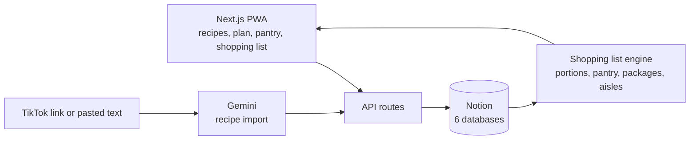

# Planning Repas

*[Version française](README.fr.md)*

[](https://github.com/figtitou-svg/planning-repas/actions/workflows/ci.yml)     

A meal planner for two (or two households): recipes, an ingredient catalogue, a pantry with expiry dates, a weekly plan, and a **shopping list generated automatically** — grouped by supermarket aisle, scaled to the number of portions, with an estimated cost.

It is a small mobile-first web app (installable as a PWA) whose database is **Notion**, so the data stays editable by hand and nothing else needs to be hosted. The interface is in French.

## Architecture at a glance



## Engineering highlights

- **Notion as a real database.** Typed repositories over six databases, plus `npm run verify:notion` that checks the live schema against what the code expects.
- **A shopping list that thinks in packages.** Quantities are scaled to the portions, the pantry is subtracted, and the result is grouped by aisle with an estimated cost.
- **Built for the supermarket.** Ticks are queued locally and flushed later, so a flaky connection never loses them.
- **Safe LLM import.** Recipe import from a TikTok link or pasted text guards the Gemini call against prompt injection and matches ingredients to the catalogue.
- **Two households** sharing recipes and ingredients, each with its own pantry, plan and shopping list. 490+ Vitest tests, strict TypeScript.

## Features

- **Recipes** with portions, ingredients and quantities; favourites; schedule a recipe for next week in two taps (calendar icon or swipe).
- **Ingredient catalogue**: unit, package size, package price, shelf life, aisle. Quantities are handled in packages, so the list says what to *buy*, not just what to use.
- **Pantry** with purchase dates and expiry — what you already have is subtracted from the shopping list.
- **Weekly plan** (read-only view, swipe or ✕ to remove a meal).
- **Shopping list** for the coming week: grouped by aisle, estimated total, tick items off while shopping (works with a flaky connection: checks are queued and flushed later).
- **Recipe import** from a TikTok link or pasted text, parsed by Gemini, with ingredients matched to the catalogue (unknown ones are created as "to complete").
- **Notifications**: items about to expire (≤ 3 days) and ingredients missing data.
- **Two households** sharing recipes and ingredients but with separate pantry, plan and shopping list.

## Stack

Next.js 15 (App Router, API routes) · React 18 · TypeScript · Notion API (`@notionhq/client`) · Gemini (recipe import) · Vitest (490+ tests) · systemd for deployment.

## Getting started

```bash
npm ci
cp .env.example .env.local     # fill in your Notion token, database IDs and (optionally) a Gemini key
npm run verify:notion          # checks your Notion databases against the schema the code expects
npm run dev                    # http://localhost:3000
npm test
```

### Notion setup

1. Create an internal integration at <https://www.notion.so/my-integrations> and put its token in `NOTION_TOKEN`.
2. Create six databases under one parent page and share the page with the integration: **Ingredients, Recipes, RecipeIngredients** (join table), **Pantry, WeeklyPlan, ShoppingChecks**. Put their IDs in `.env.local`.
3. The exact properties and types each database must have are listed in [`scripts/verify-notion-setup.ts`](scripts/verify-notion-setup.ts); `npm run verify:notion` tells you what is missing. `npm run setup:favorite` and `npm run setup:extras` add the optional properties, and `npm run setup:household` creates the databases of a second household.
4. `npm run seed:recipes` loads a few example recipes.

Household labels shown in the selector default to "Household 1/2"; set `HOUSEHOLD_1_LABEL` / `HOUSEHOLD_2_LABEL` to rename them.

## Deployment

Built to run on a small Linux VM: `npm run build && npm run start` (port 3100) under systemd — see [`deploy/planning-repas.service`](deploy/planning-repas.service). `deploy/deploy.sh` ships the tracked code and your `.env.local` over SSH, rebuilds and restarts the service; copy `deploy/deploy.env.example` to `deploy/deploy.env` to set your server.

> **Security note:** the app has no authentication by design. It is meant to be reachable only on a private network (for example a Tailscale tailnet); never expose port 3100 to the public internet.

## Project layout

```
src/app/         pages (planning, courses, recettes, stock, ingredients, notifications) and API routes
src/lib/         domain logic (shopping list, expiry, matching, households…) and Notion repositories
scripts/         Notion setup, verification and seeding scripts
deploy/          systemd unit and deploy script
public/          icon and service worker
```

## License

[MIT](LICENSE)
